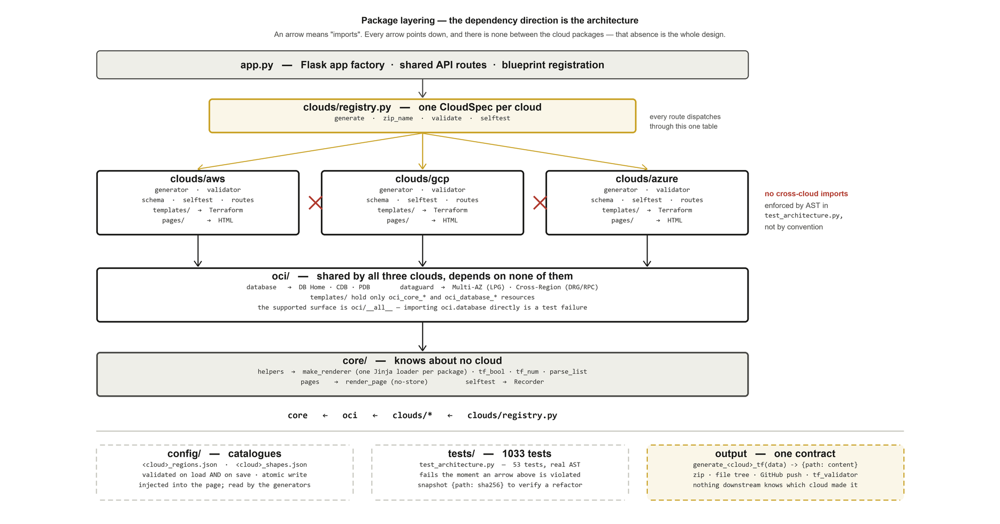

# Terraflow Studio — Code Architecture

**v5.6 · revised 18 September 2026**

This document describes how the code is arranged and why. It is about structure,
boundaries and invariants — not about how to use the app. For the product-level
tour see the technical documentation; for working agreements see `CLAUDE.md`.

---

## Table of Contents

1. [The one rule](#1-the-one-rule)
2. [How the rule is enforced](#2-how-the-rule-is-enforced)
3. [Anatomy of a cloud package](#3-anatomy-of-a-cloud-package)
4. [The registry](#4-the-registry)
5. [The generation pipeline](#5-the-generation-pipeline)
6. [The template layer](#6-the-template-layer)
7. [The for_each convention](#7-the-foreach-convention)
8. [Cross-module references](#8-cross-module-references)
9. [Catalogues](#9-catalogues)
10. [Validation, in four layers](#10-validation-in-four-layers)
11. [The self-check protocol](#11-the-self-check-protocol)
12. [Storage](#12-storage)
13. [The frontend](#13-the-frontend)
14. [Testing strategy](#14-testing-strategy)
15. [Extension points](#15-extension-points)
16. [Known debts](#16-known-debts)

---

## 1. The one rule

**A change to one cloud cannot reach another.** Everything else in this document
is downstream of that.



*Figure 1 — Package layering. Every import points down the stack; the three cloud
packages have no edge between them. Regenerate with
`python generate_architecture_diagram.py`.*

```
core/                helpers · pages · selftest          depends on nothing here
  ^
oci/                 database · dataguard · routes       depends on core only
  ^
clouds/aws/          generator · validator · schema · selftest · routes
clouds/gcp/          ... same shape                      depend on core + oci,
clouds/azure/        ... same shape                      never on each other
  ^
clouds/registry.py   one CloudSpec per cloud             imports the clouds;
                                                         nothing imports it back
```

Some duplication between the three cloud packages is accepted as the price. The
alternative — a shared abstraction over three providers whose schemas genuinely
disagree — was tried implicitly in earlier versions and produced the class of bug
this layout exists to prevent: a change made for one cloud silently altering
another's output.

**OCI sits below the clouds, not beside them.** All three cloud packages use it
for the DB Home/CDB/PDB layer and for Data Guard networking; it uses none of them.
Its Data Guard templates were once named `aws_dg_*` but contain only `oci_core_*`
resources and declare only the `oracle/oci` provider — they were never
AWS-specific, and the naming was the only thing that suggested otherwise.

### Why the arrows point this way

`core` holds the things that are the same regardless of cloud: the Jinja
environment factory, HCL value coercion (`tf_bool`, `tf_num`, `parse_list`), the
no-store page renderer, and the self-check recorder. If something in `core` needs
to know which cloud is calling, it belongs in the cloud package instead.

`clouds/registry.py` is the inversion point. Routes in `app.py` used to be
if/elif chains repeated across generate, download, validate and test; adding a
cloud meant finding every chain. They are now lookups against one table, and a
missing entry fails visibly rather than falling through to AWS.

---

## 2. How the rule is enforced

`tests/test_architecture.py` — 53 tests — parses the real AST rather than
grepping, so a rule cannot be defeated by formatting or an alias:

```python
def _imports(path):
    """Top-level module names imported by a file, from real AST rather than grep."""
    tree = ast.parse(path.read_text(encoding='utf-8'), filename=str(path))
    ...
```

What it pins:

| Class | What it refuses to let you do |
|---|---|
| `TestCoreIsIndependent` | `core` importing `oci`, any cloud, or `app` |
| `TestOciIsIndependentOfClouds` | `oci` importing a cloud, rendering a cloud-named template, or a DG template declaring a non-OCI provider |
| `TestCloudsDoNotImportEachOther` | any cross-cloud import; reaching into `oci.database` instead of the `oci` package surface |
| `TestCloudPackagesAreIsolated` | a cloud importing `app`; a validator without the uniform entry point; two clouds' `schema.py` colliding |
| `TestRoutesAreOwnedByTheirCloud` | `app.py` defining a cloud page route; a page that is cacheable; `routes` imported from `__init__` |
| `TestCloudRegistry` | a cloud package importing the registry; duplicate zip names; generate/download bypassing the registry |
| `TestTemplatesAreOwnedByTheirPackage` | a package rendering another's template; a template directory without its owner's prefix; the shared `templates/tf` tree coming back |
| `TestPagesAreOwnedByTheirPackage` | a `.html` under `templates/`, a `.j2` under `pages/`, or a page that `` another |
| `TestOciPublicSurface` | a cloud using an OCI name not in `__all__` |

If you break the layering, these fail before anything else does. That is the
point: the failure is cheap and immediate rather than discovered when an AWS edit
changes GCP output.

---

## 3. Anatomy of a cloud package

Every cloud package has the same seven parts, and nothing else:

| File | Contract |
|---|---|
| `generator.py` | `generate_<cloud>_tf(data) -> {path: content}` |
| `validator.py` | `validate(data, errors)` — payload rules for `/api/validate` |
| `schema.py` | Provider resource schema, consumed by `tf_validator.py` |
| `selftest.py` | `derive` · `check_inputs` · `module_keys` · `check_content` · `collect_cidrs` · `SECURITY_PROMPT_LINE` |
| `routes.py` | A Flask Blueprint owning the product page route |
| `templates/` | Jinja2 → **Terraform**, via `core.helpers.make_renderer` |
| `pages/` | Jinja2 → **HTML**, via the Blueprint's `template_folder` |

### Two Jinja trees, on purpose

`templates/` and `pages/` render different languages for different consumers. A
`.html` under `templates/` or a `.j2` under `pages/` is a silent mistake — the
file would still render, just through the wrong environment with the wrong
undefined-handling — so there is a test for each direction.

### Routes stay out of `__init__`

```python
bp = Blueprint('aws', __name__, template_folder='pages')
```

`template_folder='pages'` is what puts a cloud's page next to the route that
serves it. `routes.py` is deliberately *not* imported from the package
`__init__`: importing a package must not pull in Flask, so the generators stay
usable from a plain script and from tests without an app context.

The catalogues are injected into the page rather than fetched by it, so the
dropdowns are populated on first paint:

```python
return render_page('aws.html',
                   aws_regions_json=regions.regions_json('aws'),
                   aws_shapes_json=shapes.shapes_json('aws'),
                   aws_default_shape=shapes.default_shape('aws'))
```

`core.pages.render_page` exists only to stamp `no-store` on every product page.
The pages embed generated state, so a stale copy out of bfcache would show a
config the server would no longer produce.

---

## 4. The registry

```python
@dataclass(frozen=True)
class CloudSpec:
    name: str
    generate: Callable[[dict], dict]
    zip_name: str
    validate: Optional[Callable[[dict, dict], None]] = None
    selftest: object = None
```

Five entries: `aws`, `gcp`, `azure`, `oci`, `dg`. `validate` is `None` for `oci`
and `dg` — they are validated in the browser — and `None` is distinct from a
no-op on purpose, so "nothing to check here" cannot be confused with a missing
entry.

`get(cloud)` falls back to AWS, matching what the routes have always done. The
whole of generation dispatch is then two lines:

```python
def generate_all(data: dict) -> dict:
    # CloudFormation is an output format rather than a cloud, so it is checked
    # before the registry: it only applies to AWS and produces a single file.
    if data.get('iac_tool') == 'cloudformation':
        return {'cfn': generate_cfn(data)}
    return cloud_registry.get(data.get('cloud', 'aws')).generate(data)
```

CloudFormation is handled ahead of the lookup rather than as a sixth `CloudSpec`
because it is an *output format* for one cloud, not a cloud. Modelling it as a
CloudSpec would have given it a zip name and a validator it has no use for.

---

## 5. The generation pipeline

Every cloud follows the same four stages. The stages are the architecture; the
contents differ per cloud because the providers differ.

```
payload (JSON from the browser, or a saved config)
   │
   ├─ 1. defaults      _aws_net_defaults(d), _gcp_cluster_defaults(d, ...), ...
   │                   one per card type. Fills every key the templates read,
   │                   so a template never sees a missing variable.
   │
   ├─ 2. context       _mod3_ctx(d, mn0, mn1) and friends.
   │                   Resolves cross-module references into map keys, decides
   │                   which module variant an instance lands in.
   │
   ├─ 3. render        render_tf('aws_vm_cluster/main.tf.j2', **ctx)
   │                   per-package renderer, StrictUndefined.
   │
   └─ 4. assemble      {path: content} — the single return type.
                       Root files plus modules/<dir>/{main,variables,outputs,tfvars}.
```

**`{path: content}` is the only contract between a generator and everything
else.** Download zips it, `/api/files` lists its keys to build the file tree,
`/api/generate` returns one value from it, the GitHub push iterates it, and
`tf_validator` consumes it. Nothing downstream knows which cloud produced it.

Two things wrap the dict on the way out:

- `_fmt_files(files, iac_tool)` runs the real `terraform fmt` over the content
  when a binary is available, so downloaded and pushed output is canonically
  formatted rather than however the templates happened to indent.
- Download also writes `terraflow_config.json` into the zip — the payload that
  produced it — which is what makes Load-ZIP a true round trip.

### Defaults are not cosmetic

The defaults layer exists because `StrictUndefined` is on. A missing variable
must fail loudly at render time rather than silently producing `""` in generated
HCL, which is how you get a `.tf` file that is syntactically fine and
semantically wrong. The cost is that every key a template reads must be
materialised first, and that is exactly what `_<cloud>_<card>_defaults` is for.

---

## 6. The template layer

```python
def make_renderer(template_root):
    """A render_tf bound to one directory of templates.

    Each package owns its templates and gets its own loader, so a cloud can only
    render its own: reaching for another cloud's template raises TemplateNotFound
    rather than quietly working.
    """
```

One loader per package, not a shared search path. A shared path is what lets two
clouds drift into each other — someone reuses `aws_root/variables.tf.j2` from the
GCP generator, it works, and now an AWS change breaks GCP. With separate loaders
that is a `TemplateNotFound` on the first run.

Environment settings, all deliberate:

| Setting | Why |
|---|---|
| `StrictUndefined` | a missing variable must fail, not render `''` |
| `trim_blocks` / `lstrip_blocks` | control tags do not leave blank lines in HCL |
| `keep_trailing_newline` | files end with exactly one newline |
| `.rstrip('\n')` on output | the assembler controls trailing whitespace, not each template |

**103 `.j2` files across 27 resource directories.** Directory names carry their
owner's prefix (`aws_`, `gcp_`, `azure_`, `oci_`), and a test pins that.

### Template-level facts worth knowing

`terraform fmt` aligns each run of arguments *between comments* separately. That
makes the comment above `database_server_type` in
`azure_exadata_infra/main.tf.j2` load-bearing: the block above keeps its own
width and the block below widens to fit the longer key. `TestTerraformFmt`
catches it if that changes.

---

## 7. The for_each convention

AWS and GCP emit **one `for_each` module per resource type**. Instances live in
`terraform.auto.tfvars`, so adding one does not touch `main.tf`:

```hcl
module "aws_vm_cluster" {
  source   = "./modules/aws-vm-cluster"
  for_each = var.aws_clusters
  ...
}
```

Azure is still one module directory per instance, named after the module. It is
the remaining holdout.

### What this changed

A reference is now a **map key**, not a module name. Deploy Guide `-target`
commands name `module.aws_vm_cluster["c1"]`, never the pre-for_each
`module.c1`. The OCI DB Home/CDB/PDB modules are the exception — genuinely one
module per instance — so `module.<name>_dbhome` is correct there.

### Emit-only-when-used

A module directory is written only when its map has an entry. This matters most
where a resource has two mutually exclusive forms:

- `aws-avmcluster` (id pair, fed by `aws_avmclusters`) and `aws-avmcluster-arn`
  (arn pair, fed by `aws_avmclusters_arn`). The provider accepts one pair or the
  other and never both — **and a `null` value still counts as present**, so the
  unused pair must be *omitted*, not set to `null`. Two directories is the only
  way to express that in HCL.
- `gcp-odb-network` (client + backup subnet) and `gcp-odb-network-adbs` (client
  only), selected by the ODB Network `purpose` flag.

The GCP pair deserves its reasoning stated, because a `count` looks cheaper:
Terraform cannot make a resource conditional without changing its address, so a
count would rewrite `google_oracle_database_odb_subnet.backup` to `...backup[0]`
in **every existing configuration** — a state move, and a proposed destroy of a
live backup subnet for anyone who had already applied. Two directories leaves
`gcp-odb-network` untouched byte for byte.

**The general principle: a config that does not use a feature must generate
byte-identical output to what it generated before the feature existed.** That
constraint is why new capability arrives as a new module directory or a
conditionally-emitted locals block, rather than as an edit to an existing one.

---

## 8. Cross-module references

A card stores a **module name**; the context builder turns it into a map key; the
root indexes the for_each module by that key.

```hcl
cloud_exadata_infrastructure_id = module.aws_exadata_infra[each.value.infra_ref].infra_id
odb_network_id                  = module.aws_odb_network[each.value.network_ref].network_id
```

A reference naming a module this config does not build is **retargeted or
blanked** in the generator rather than emitted, because a dangling key fails at
apply on a missing map entry. GCP retargets an ADB's `network_ref` to the first
network; Azure blanks an ADB's `vnet_ref` when the VNet was never generated.

### Brownfield: the locals indirection

An AWS ODB Network or Exadata Infra can be flagged as provisioned outside
Terraform (`is_existing` + `existing_id`). When any entry is external, the
expression swaps:

```python
def _infra_id_expr(external_infras, key='each.value.infra_ref'):
    return (f'local.infra_ids[{key}]' if external_infras
            else f'module.aws_exadata_infra[{key}].infra_id')
```

and `main.tf` grows a merge:

```hcl
locals {
  infra_ids = merge(
    { for k, m in module.aws_exadata_infra : k => m.infra_id },
    var.existing_infra_ids,
  )
}
```

Managed instances and external IDs share one keyspace, so `infra_ref` keeps
working unchanged either way. The locals and the `existing_*` variables appear
**only** when at least one entry is external — the byte-identical rule again.

Note for anyone writing assertions: `main.tf` always has *a* `locals` block now,
for DB server discovery. Assert on `infra_ids = merge(`, not on `locals {`.

GCP and Azure have no brownfield support. GCP is the harder one: its ODB network
module creates the network *and both subnets*, so an existing network is a triple
(`odb_network_name`, `client_subnet_name`, `backup_subnet_name`), not one ID.

### `db_servers_mode`

Three values on both `aws_clusters` and `aws_avmclusters`, resolved in root
locals:

| Value | Servers offered |
|---|---|
| `auto` (default) | every server on the infrastructure |
| `unallocated` | only servers whose `vm_cluster_ids` **and** `autonomous_vm_cluster_ids` are empty |
| `manual` | exactly the `db_servers` list |

`auto` deliberately includes servers other clusters already use. A DB server
hosts one VM per cluster and reports allocated-versus-total capacity — the
existence of `cpu_core_count`/`max_cpu_count` and of `vm_cluster_ids` as a *list*
only makes sense if servers are shared. Filtering unconditionally would break the
ordinary case of adding a second cluster to an existing infrastructure, where
usually every server is allocated and the filter returns empty.

The data source's `for_each` filters on `!= "manual"`, **not** `== "auto"` —
filtering on `auto` would leave `unallocated` clusters without a lookup and
silently fall back to their empty list. `cluster_db_servers` then covers *every*
cluster via `lookup(..., v.db_servers)`, so manual entries need no data source
and nothing indexes a missing key.

`db_servers_mode` is read by this configuration and never by the provider, so
root `variables.tf` carries a `validation` block per map. The browser can only
send the three values; the guard is for a hand-edited `terraform.auto.tfvars`.

---

## 9. Catalogues

`catalogue.py` holds the machinery; `regions.py` and `shapes.py` are thin
per-domain wrappers over it. One shape for both:

```
load(path, cloud, validate_fn, cache, key, refresh=False)
field_order(entries, preferred)     # follow the file's own field order
dumps(doc, key, order)              # one line per entry, column-aligned
write_atomic(path, body, prefix)    # temp file + os.replace
```

Four properties, each for a reason:

- **Validated on load.** Malformed config raises rather than rendering an empty
  dropdown. A silent empty dropdown is worse than a startup failure.
- **Validated on save, through the same function.** A rejected save writes
  nothing and leaves the file exactly as it was. Without this the `/regions`
  editor could empty every dropdown in the app at the next load.
- **Atomic write.** Truncated JSON breaks every product page.
- **One line per entry, column-aligned.** `json.dumps(indent=2)` would turn a
  one-word edit into a 250-line diff. Field order follows the file, so Azure
  keeping `group` before `status` survives a round trip, and saving twice is
  byte-stable.

`save()` refreshes the cache, so no restart is needed.

A stored value the catalogue no longer lists is **kept and marked
`(not in catalogue)`** rather than silently rewritten — the same reason the
region editor keeps a `null` `oci_region`. Silently rewriting user data to fit a
catalogue is how you lose a deliberate choice.

---

## 10. Validation, in four layers

Each catches a different class of error, and none subsumes another.

| Layer | Runs | Catches |
|---|---|---|
| Browser | as you type | required fields, formats, filtered reference dropdowns |
| `/api/validate` | on demand | payload rules the browser cannot express — cross-card CIDR overlap, reference legality, shape-conditional requirements |
| `tf_validator.py` | on demand | structural HCL: file presence, balanced delimiters, provider constraints, schema conformance, var/output resolution, cross-module refs, tfvars completeness |
| `/api/tf-cli` | on demand | the real `terraform`/`tofu` `fmt` + `init` + `validate` |

`tf_validator.py` merges the `schema.py` from each cloud package, so a cloud
describes its own resources. Eight check groups; a resource type unknown to every
schema is a failure, not a pass.

Server-side validation is dispatched by tab number, ranged per cloud — AWS 0–4,
GCP 10–15, Azure 20–23 — and each cloud's validator owns its own block. The
ranges leave room to add a resource without renumbering another cloud.

`errors_by_module` is returned alongside `errors` so the page can open and
highlight the specific failing card, not just report that something is wrong.

### Rules that cross cards

Some constraints only exist between instances, which is why they cannot live in
the browser:

- Azure: two VM clusters on one delegated subnet must not claim overlapping
  backup ranges. The delegated subnet is shared by design; the backup range is
  carved inside the VNet per cluster, so it is not.
- GCP: a VM Cluster may not reference an `adbs` network (no backup subnet), and
  an ADB may not reference a `dedicated` one. Enforced both ways.

---

## 11. The self-check protocol

`/api/test` runs a functional self-check. `core/selftest.py` holds only the part
that is the same for every cloud — a `Recorder` that runs a check, catches what
it raises, and accumulates `{group, name, status, error}` rows.

Checks are passed as **zero-argument callables rather than booleans**, so the
condition is evaluated inside the `try`. A payload with `compute_count="abc"`
should fail one check, not raise out of the route.

Each cloud contributes through `clouds/<cloud>/selftest.py`:

| Name | Supplies |
|---|---|
| `derive(payload)` | the normalised instance lists this cloud checks |
| `check_inputs(d, t)` | required-field checks |
| `module_keys(d)` | which module directories should exist |
| `check_content(d, files, t)` | assertions against generated content |
| `collect_cidrs(data)` | `(label, cidr)` pairs for the overlap review |
| `SECURITY_PROMPT_LINE` | the provider-specific risk named in the security prompt |

`collect_cidrs` being per-cloud is a fix, not decoration: a single shared
collector silently gave Azure no CIDR findings at all, because it only knew the
AWS and GCP payload keys.

---

## 12. Storage

Two backends behind one interface — `save` · `load` · `list_customers` ·
`delete` · `backend_name`.

- **FileStore** (default): `data/{customer-slug}/{cloud}.json`. No dependencies.
- **CouchDBStore**: pure `urllib` REST, no third-party package. Activates when
  `COUCHDB_URL` is set.

Selection happens once at startup by probing the URL, and falls back to
FileStore silently if unreachable. The app logs which backend is live and the UI
shows it as a pill, because a silent fallback you cannot see is a support call.

No third-party CouchDB client is a deliberate constraint: the storage layer is
the one part that must work in a bare `pip install -r requirements.txt` with no
services running.

---

## 13. The frontend

No framework. Each product page is a standalone Jinja template — **none extends
or includes another** — which is precisely what lets them live in separate
packages. If one grows an ``, the parent must stay reachable from
every Blueprint, and the isolation is gone. There is a test.

State is plain arrays, one per card type:

```js
// clouds/aws/pages/aws.html
awsNets, awsInfras, awsPeerings, awsClusters, awsAvmcs, awsOciDbs
// clouds/gcp/pages/gcp.html
gcpNets, gcpInfras, gcpClusters, gcpAdbs
// clouds/azure/pages/azure.html
azureVnets, azureInfras, azureClusters, azureAdbs
```

Each type has the same five functions: `def<X>(i)` (defaults), `add<X>()`,
`read<X>(i)`, `<x>CardHTML(d,i)`, `render<X>s()`. `buildPayload()`, `renderAll()`
and `applyConfig()` are the three places that must know about every array.

### Standalone pages, shared chrome

Standalone does not mean triplicated. Page chrome that is not cloud logic lives
in `static/`:

- `app.css` — the one stylesheet; every page links it
- `shape-select.js` — shape and server-type dropdowns, built from the injected
  catalogue. It holds **no shape values of its own**; each page passes its own.
- `guide-export.js` — Deploy Guide → PDF / Markdown

`tests/test_all.py::TestInlineHandlersAreDefined` resolves inline `onclick=`
handlers against both the page's inline `<script>` blocks and any `static/`
script it loads, so moving a handler into `static/` cannot silently orphan it.

---

## 14. Testing strategy

**1033 tests across 7 files. All must pass.**

| File | Tests | Covers |
|---|---|---|
| `tests/test_all.py` | 530 | End-to-end generation, API routes, cross-cloud |
| `tests/test_gcp.py` | 158 | GCP modules and validation |
| `tests/test_azure.py` | 143 | Azure modules and validation |
| `tests/test_shapes.py` | 57 | Shape catalogues, the editor API, required server types |
| `tests/test_architecture.py` | 53 | Package layering and ownership rules |
| `tests/test_regions.py` | 50 | Region catalogues and OCI region mapping |
| `tests/test_aws.py` | 42 | AWS modules and validation |

```bash
python -m unittest discover -s tests -p "test_*.py"
```

### For refactors, a passing suite is not sufficient evidence

Snapshot generated output — `{path: sha256}` for every config under `data/` —
before and after, and diff it. That technique caught two regressions during the
package split that the suite missed, because the suite asserts on properties
while a refactor can change output in ways no property names.

### Assertions should be relative, not absolute

A test that hardcodes a count derived from live catalogue data breaks every time
the catalogue grows. Prefer `before + 1` over a literal. Where a literal *is* the
point — `test_the_saved_configs_that_this_now_flags` pins that 8 of the 11 stored
AWS infras are newly invalid — say so in the docstring, so the number moving
reads as a deliberate act rather than a surprise.

---

## 15. Extension points

### Adding a resource to an existing cloud

1. Templates in `clouds/<cloud>/templates/<cloud>_<resource>/` — main, variables,
   outputs, tfvars
2. Context builder and generators in `clouds/<cloud>/generator.py`
3. In the page: `def<X>(i)`, `add<X>()`, `read<X>(i)`, `<x>CardHTML(d,i)`,
   `render<X>s()`, state array
4. Tab and page div
5. Wire into `buildPayload()`, `renderAll()`, `applyConfig()`
6. Wire into `generate_<cloud>_tf()`
7. Rules in `validator.py`, checks in `selftest.py`
8. Run the suite

### Adding a cloud

1. `clouds/<cloud>/` with the seven parts from §3
2. One `CloudSpec` line in `clouds/registry.py`
3. Register the Blueprint in `app.py`
4. `config/<cloud>_regions.json` and `config/<cloud>_shapes.json`
5. Merge its schema in `tf_validator.py`

**Nothing else should need to change. If it does, that is coupling worth
removing** — and it is the most useful signal this architecture produces. The
`/regions` editor needing no UI work for a new cloud, because its columns are
driven by `regions.OPTIONAL_FIELDS`, is the shape to aim for.

---

## 16. Known debts

Recorded rather than hidden. None is load-bearing; all are worth a pass.

**`app.py` re-exports 60 generator internals it never calls.** Of 61 names
imported from `core.helpers` and the four generator modules, only `generate_cfn`
is used by `app.py`'s own logic. The rest are there because
`tests/test_all.py`, `test_aws.py`, `test_azure.py` and `test_gcp.py` import them
*through* `app` rather than from the owning package. That is a live coupling: it
means a cloud package's internals are part of `app.py`'s surface. The fix is for
the tests to import from `clouds.aws.generator` directly, after which the import
block can go.

**`core.helpers.render_tf` is dead and points at a directory that no longer
exists.** The legacy shared renderer is rooted at `templates/tf`, which the
package split removed. It is imported by `app.py` and never called; calling it
would raise `TemplateNotFound`. Delete both the renderer and the import.

**`app.py`'s module docstring is stale** — it says the app covers "Oracle
AI Database@AWS and AI DB@GCP" and renders "from Jinja2 templates in `templates/tf/`".
Neither is true.

**`oci/__init__.py` exports 20 names, most underscore-prefixed.** The cloud
generators reach into OCI internals (`_ocidb_filled`, `_mn_dbhome`) to decide
whether a DB stanza is filled in and to compute module names. The package is
honest about it in its own docstring; narrowing the surface is a behavioural
change and was deliberately left out of the extraction.

**`app.py` still holds cloud-aware prompt text in `api_llm_ask`** — the same
shape as the `_collect_cidrs` bug that silently gave Azure no CIDR findings.
Cloud-specific text belongs in the cloud's `selftest.py`, next to
`SECURITY_PROMPT_LINE`.

**`templates/base.html` (1875 lines) is dead.** Nothing extends, includes or
renders it. The pages became standalone and it was never removed.

**`/api/test` reports two spurious failures for `oci` and `dg`** — "root main.tf
generated" and "root terraform.auto.tfvars generated". Those products emit
`dg_multi_az_*/main.tf` rather than a root module, so the checks do not apply.
The self-check needs a way for a product to declare it has no root module.

**Azure has not moved to `for_each`.** It still emits one module directory per
instance. The migration is the same shape as the AWS and GCP ones, and the AVMC
case shows how to stage it without breaking existing state.

---

*Structure exists to make one kind of mistake impossible. When a rule here stops
earning that, change the rule and the test together — deliberately, in one
commit — rather than working around it.*
